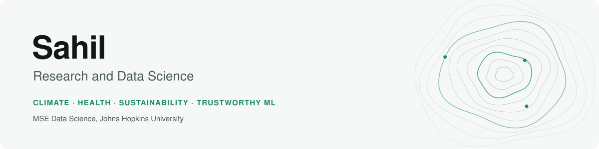

<picture>
  <source media="(prefers-color-scheme: dark)" srcset="assets/banner-dark.svg">
  
</picture>

I'm a data science graduate student at Johns Hopkins. I use data to study how countries and cities balance development against pressure on the planet, and I'm increasingly focused on making machine learning **trustworthy**: fair, interpretable and robust.

- 🎓 **MSE in Data Science**, Johns Hopkins University (2026–2028), Departmental Scholarship
- 🌍 **BSc in Analytics and Sustainability Studies**, Tata Institute of Social Sciences, Mumbai
- 🔬 Currently working on neighbourhood-level heat-health risk in Baltimore
- 📫 sfnu1@jh.edu

## Featured work

<table>
<tr>
<td width="50%" valign="top">

<h3><a href="https://github.com/sahiljangra12/Thesis">Planetary Boundaries and Development</a></h3>
Builds a Planetary Pressure Index for 182 countries, groups countries by development and pressure, and tracks how they moved between groups from 1990 to 2023. Written as a tested Python package with CI, plus an <a href="https://sahiljangra12.github.io/Thesis/">interactive chart</a>. 
Python · scikit-learn · pandas · pytest · GitHub Actions
</td>
<td width="50%" valign="top">

<h3><a href="https://github.com/sahiljangra12/Academic-Projects">Academic Projects</a></h3>
SDG dashboards in Power BI and Excel, energy profiles, speech signal processing, a MATLAB hurricane-damage analysis and linear programming models. 
Power BI · Excel · Python · MATLAB
</td>
</tr>
</table>

## Toolkit

**Languages and analysis:** Python (pandas, NumPy, scikit-learn, SciPy, matplotlib) · MATLAB 
**Visualisation:** Power BI · Excel · matplotlib 
**Workflow:** Jupyter · Git · pytest · GitHub Actions
