<picture>
  <source media="(prefers-color-scheme: dark)" srcset="assets/banner-dark.svg">
  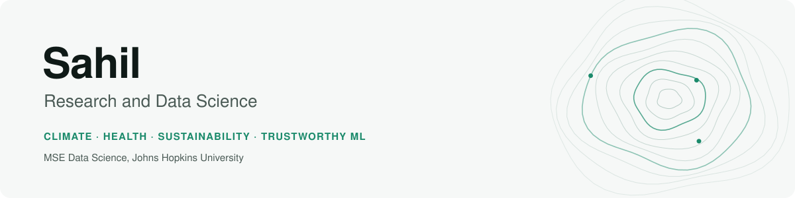
</picture>

<a href="https://sahiljangra12.github.io"><picture><source media="(prefers-color-scheme: dark)" srcset="assets/btn-website-dark.svg"></picture></a>
<a href="mailto:sfnu1@jh.edu"><picture><source media="(prefers-color-scheme: dark)" srcset="assets/btn-email-dark.svg"></picture></a>
<a href="https://sahiljangra12.github.io/Thesis/"><picture><source media="(prefers-color-scheme: dark)" srcset="assets/btn-chart-dark.svg"></picture></a>
<a href="https://github.com/sahiljangra12/Academic-Projects"><picture><source media="(prefers-color-scheme: dark)" srcset="assets/btn-projects-dark.svg"></picture></a>

I'm a data science graduate student at Johns Hopkins. I study how countries and cities balance development against pressure on the planet, using survey data, statistical models and machine learning, and I care about making that machine learning **trustworthy**: fair, interpretable and robust.

**New:**
- [Charm City Pulse](https://sahiljangra12.github.io/charm-city-pulse/): a live app for Baltimore. It answers "is it safe to be outside today?" and "how does my block compare?", and points people to the nearest cooling or warming center. Its data rebuilds itself every morning.
- [Do new street trees cool Baltimore?](https://github.com/sahiljangra12/baltimore-tree-cooling): a causal event study of 20 years of Landsat data and the city's tree inventory. Each young street tree cools its block measurably within a decade.
- [Baltimore Heat Atlas](https://github.com/sahiljangra12/baltimore-heat-atlas): a validated heat vulnerability index for Baltimore's census tracts, with a paper and a live dashboard.

**Live:** [Charm City Pulse](https://sahiljangra12.github.io/charm-city-pulse/) · [Baltimore Heat Atlas](https://sahiljangra12.github.io/baltimore-heat-atlas/) · [Global Sustainability Explorer](https://sahiljangra12.github.io/global-sustainability-explorer/) · [Energy transition dashboard](https://sahiljangra12.github.io/energy-transition-analysis/) · [SDG Explorer India](https://sahiljangra12.github.io/sdg-explorer-india/) · [Climate boundary study](https://sahiljangra12.github.io/planetary-pathways/) · [Thesis study](https://sahiljangra12.github.io/Thesis/)

## Featured research

<table>
<tr>
<td width="50%" valign="top">
<a href="https://sahiljangra12.github.io/charm-city-pulse/">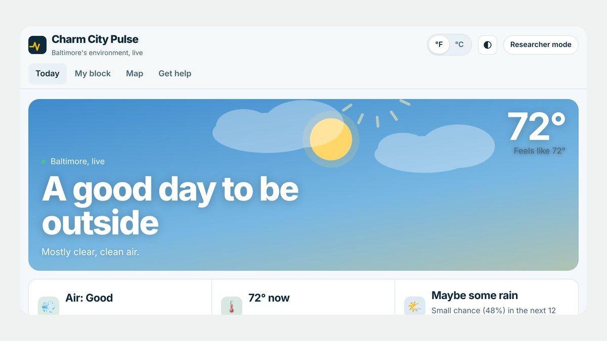</a>
</td>
<td width="50%" valign="top">
<h3><a href="https://github.com/sahiljangra12/charm-city-pulse">Charm City Pulse: Baltimore's environment, live</a></h3>
The research turned into a public tool. Residents get a plain-language answer about today's heat, cold, air and alerts (NWS, EPA AirNow, USGS, FEMA), a report on their own block with its flood risk, and the nearest cooling or warming center. Researcher mode opens 54 indicators for 199 census tracts and 55 neighbourhoods, with margins of error. A GitHub Actions job rebuilds the newest Census ACS, CDC PLACES and city layers every morning and keeps the last good copy if a source fails.
  <a href="https://sahiljangra12.github.io/charm-city-pulse/"><b>Open the app →</b></a>
 JavaScript · Leaflet · Chart.js · Python data pipeline · GitHub Actions · live public APIs · installable web app
</td>
</tr>
<tr>
<td width="50%" valign="top">
<a href="https://github.com/sahiljangra12/baltimore-tree-cooling">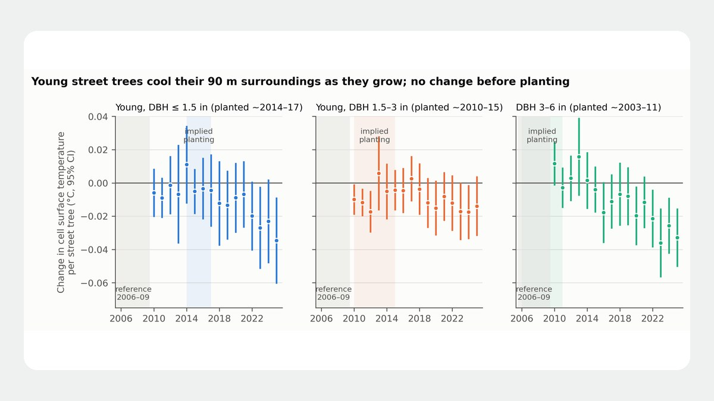</a>
</td>
<td width="50%" valign="top">
<h3><a href="https://github.com/sahiljangra12/baltimore-tree-cooling">Do New Street Trees Cool Baltimore?</a></h3>
A within-neighbourhood event study of 15,166 90 m cells and 111 Landsat summer scenes from 2006 to 2025. Empty planting sites that the city judged plantable serve as the comparison group. Each young street tree lowered its cell's summer surface temperature by 0.026 °C by 2022–25 (95% CI 0.005–0.047), with no change before planting (pre-trend p = 0.63). That is about 0.13 °C for an ordinary planted block face. A naive neighbourhood comparison overstates the effect three- to four-fold.
  <a href="https://github.com/sahiljangra12/baltimore-tree-cooling/blob/main/paper/Baltimore_Street_Trees_Cooling_Sahil_2026.pdf"><b>Paper (PDF) →</b></a> &nbsp;·&nbsp; <a href="https://github.com/sahiljangra12/baltimore-tree-cooling"><b>Replication package →</b></a>
 Python · Landsat 5/7/8/9 · two-way fixed effects · event study · sensitivity analysis (Cinelli–Hazlett) · LaTeX · CI-verified
</td>
</tr>
<tr>
<td width="50%" valign="top">
<a href="https://sahiljangra12.github.io/baltimore-heat-atlas/">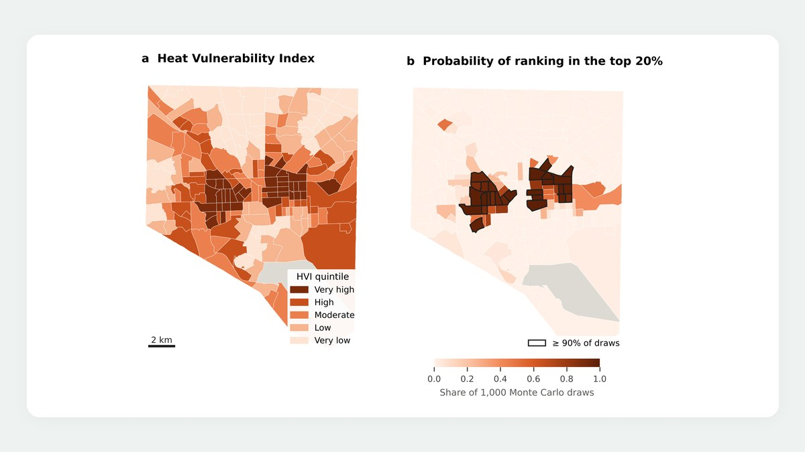</a>
</td>
<td width="50%" valign="top">
<h3><a href="https://github.com/sahiljangra12/baltimore-heat-atlas">Baltimore Heat Atlas: Where Heat Meets Vulnerability</a></h3>
Which Baltimore neighbourhoods are most at risk in summer heat? Seven summers of Landsat and MODIS heat, CDC PLACES health and ACS 2020–2024 data rank 198 census tracts. Ground temperature where people live ranges from 35.7 to 47.5 °C. Tree cover tracks it at ρ = −0.88, and areas redlined in 1937 run 4.4 °C hotter. The index tracks heat-related EMS calls (ρ = 0.69); the CDC Social Vulnerability Index does not (ρ = 0.27).
  <a href="https://sahiljangra12.github.io/baltimore-heat-atlas/"><b>Live dashboard →</b></a> &nbsp;·&nbsp; <a href="https://github.com/sahiljangra12/baltimore-heat-atlas/blob/main/paper/Baltimore_Heat_Vulnerability_Sahil_2026.pdf"><b>Paper (PDF) →</b></a>
 Python · Landsat / MODIS · GeoPandas · rasterio · PySAL · Monte Carlo · d3.js · LaTeX
</td>
</tr>
<tr>
<td width="50%" valign="top">
<a href="https://sahiljangra12.github.io/planetary-pathways/">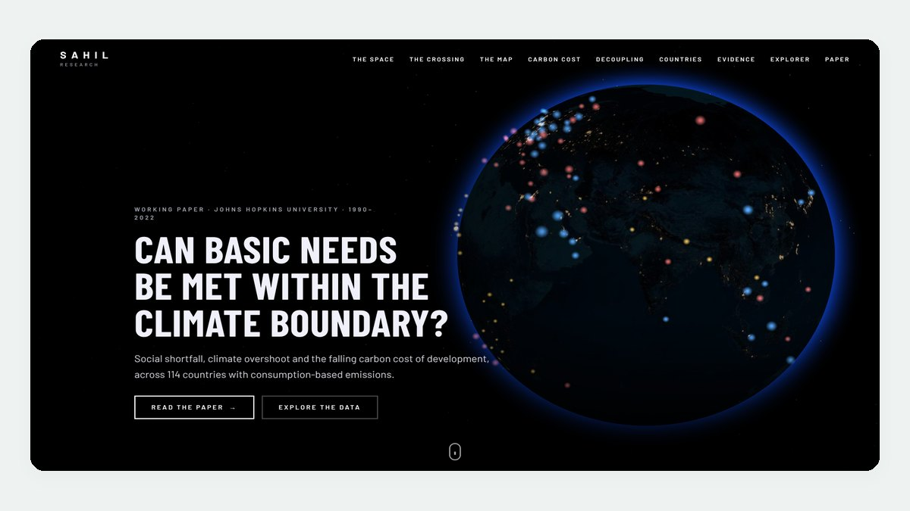</a>
</td>
<td width="50%" valign="top">
<h3><a href="https://sahiljangra12.github.io/planetary-pathways/">Can Basic Needs Be Met Within the Climate Boundary?</a></h3>
Working paper · Social Shortfall, Climate Overshoot and the Falling Carbon Cost of Development  
Can countries meet basic needs within a fair share of the climate boundary? Across 114 countries from 1990 to 2022, none met four social thresholds while emitting under 1.61 t CO₂ per person. The CO₂ at which half of countries meet them fell from about 26 t to 8.5 t, still 5.3 times the boundary, and only 2 of 41 decoupling countries are cutting fast enough to reach it by 2050.
  <a href="https://sahiljangra12.github.io/planetary-pathways/"><b>Study site →</b></a> &nbsp;·&nbsp; <a href="https://github.com/sahiljangra12/planetary-pathways/blob/main/paper/main.pdf"><b>Paper (PDF) →</b></a> &nbsp;·&nbsp; <a href="https://github.com/sahiljangra12/planetary-pathways"><b>Code →</b></a>
 Python · statsmodels · cluster bootstrap · LaTeX · three.js · D3 geo · fully reproducible
</td>
</tr>
</table>

## Research projects

<table>
<tr>
<td width="50%" valign="top">
<a href="https://sahiljangra12.github.io/global-sustainability-explorer/">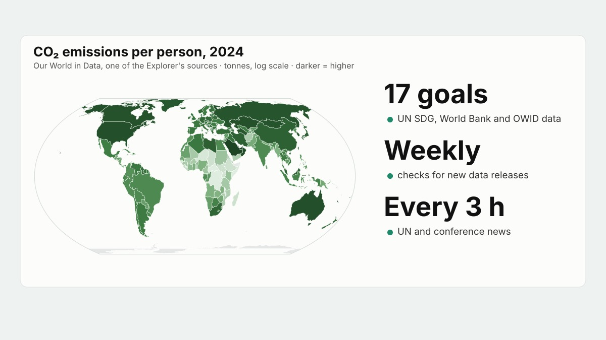</a>
<h3><a href="https://github.com/sahiljangra12/global-sustainability-explorer">Global Sustainability Explorer</a></h3>
Explore, compare and cite sustainability data for all 17 goals: drill from goal to target, indicator and breakdown, and from world to region to country, for any year range. A weekly pipeline re-downloads only the series whose release changed, validates them and keeps the last good copy; UN and conference news refreshes every 3 hours.
  <a href="https://sahiljangra12.github.io/global-sustainability-explorer/"><b>Explorer →</b></a>
 Python · UN SDG API · World Bank WDI · OWID · Parquet · GitHub Actions · Observable Plot
</td>
<td width="50%" valign="top">
<a href="https://github.com/sahiljangra12/sdg-explorer-india">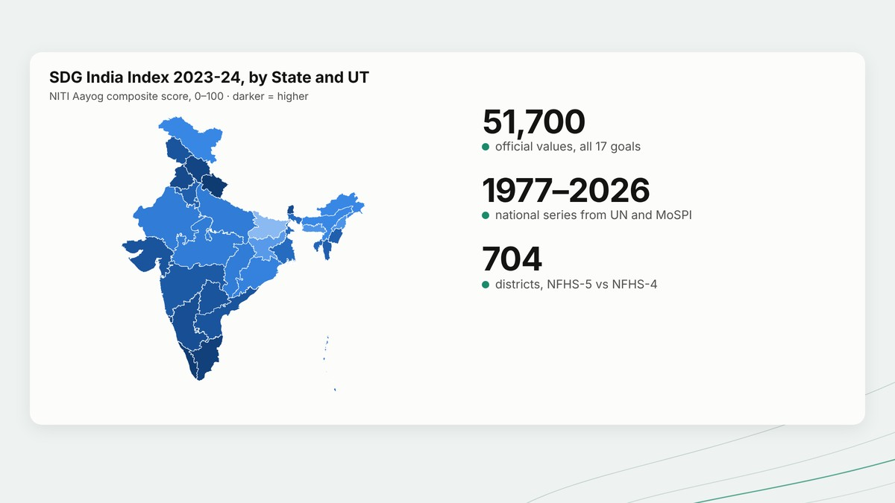</a>
<h3><a href="https://github.com/sahiljangra12/sdg-explorer-india">SDG Explorer India</a></h3>
India's progress on all 17 goals from four official sources: 51,700 values, national series back to 1977 and 704 districts, with every gap shown rather than filled.
  <a href="https://sahiljangra12.github.io/sdg-explorer-india/"><b>Explorer →</b></a>
 Python · PDF table extraction · validation · Plotly
</td>
</tr>
<tr>
<td width="50%" valign="top">
<a href="https://github.com/sahiljangra12/energy-transition-analysis">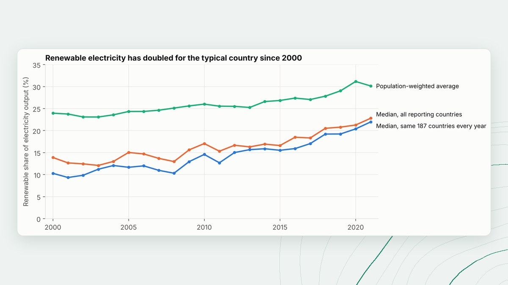</a>
<h3><a href="https://github.com/sahiljangra12/energy-transition-analysis">Energy Transition and Development</a></h3>
Renewable energy across 215 countries: the typical country's renewable electricity share doubled from 2000 to 2021, and "renewable share" tells opposite stories about income for electricity and for all energy. The dashboard explores any country's electricity mix through 2024.
  <a href="https://sahiljangra12.github.io/energy-transition-analysis/"><b>Dashboard →</b></a> &nbsp;·&nbsp; <a href="https://github.com/sahiljangra12/energy-transition-analysis/blob/main/docs/technical-report/energy_transition_technical_report.pdf"><b>Report (PDF) →</b></a>
 Python · World Bank and UN SDG data · regression · Plotly
</td>
<td width="50%" valign="top">
<a href="https://sahiljangra12.github.io/Thesis/">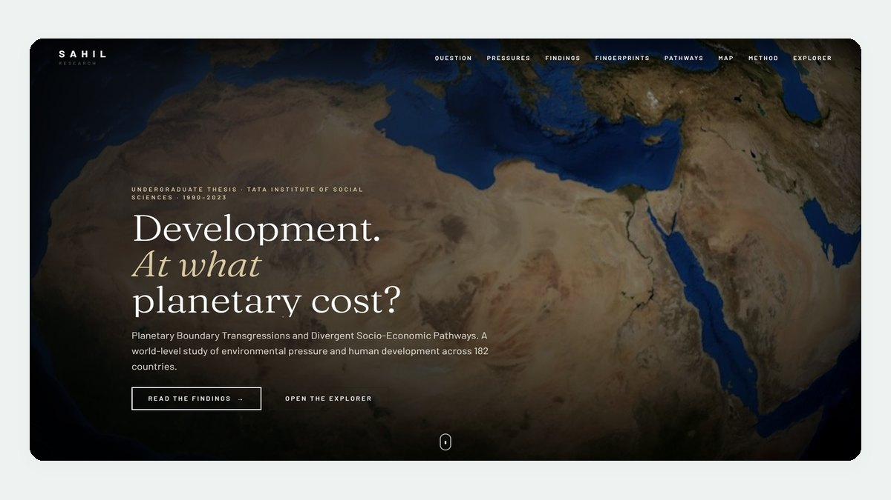</a>
<h3><a href="https://sahiljangra12.github.io/Thesis/">Development. At What Planetary Cost?</a></h3>
My undergraduate thesis: a Planetary Pressure Index for 182 countries, pressure fingerprints for every country, four development–pressure profiles and how countries moved between them from 1990 to 2023.
  <a href="https://sahiljangra12.github.io/Thesis/"><b>Study site →</b></a> &nbsp;·&nbsp; <a href="https://github.com/sahiljangra12/Thesis"><b>Code and data →</b></a>
 Python · scikit-learn · pytest · D3 geo · interactive essay
</td>
</tr>
</table>

## Selected coursework

<table>
<tr>
<td width="33%" valign="top">
<a href="https://github.com/sahiljangra12/Academic-Projects/tree/main/01-mumbai-aqi-forecasting">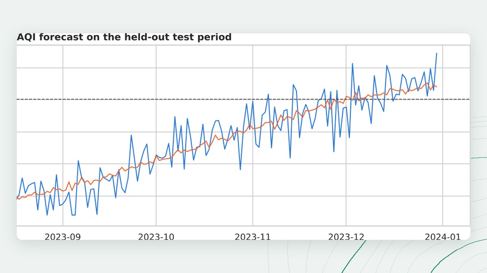</a>
<h3><a href="https://github.com/sahiljangra12/Academic-Projects/tree/main/01-mumbai-aqi-forecasting">Mumbai Air Quality Forecasting</a></h3>
Explains, flags and forecasts daily AQI. The next-day model cuts error by 30% compared with a persistence baseline and warned a day ahead for 19 of 28 high-pollution days.
 Python · scikit-learn · time-ordered validation
</td>
<td width="33%" valign="top">
<a href="https://github.com/sahiljangra12/Academic-Projects/tree/main/03-health-survey-analytics">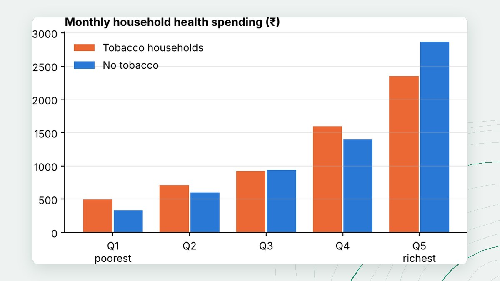</a>
<h3><a href="https://github.com/sahiljangra12/Academic-Projects/tree/main/03-health-survey-analytics">Health Survey Analytics</a></h3>
Survey-weighted analysis of Indian government microdata for Uttarakhand: hospital use, out-of-pocket costs, and whether tobacco spending crowds out health spending.
 Python · survey weights · NSS / HCES microdata
</td>
<td width="33%" valign="top">
<a href="https://github.com/sahiljangra12/Academic-Projects/tree/main/02-people-analytics">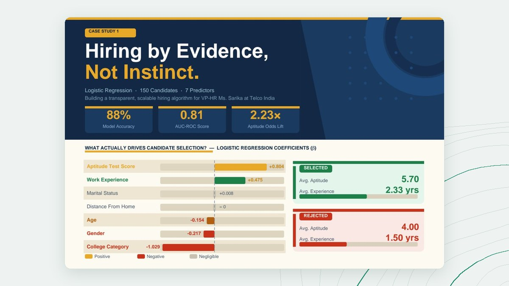</a>
<h3><a href="https://github.com/sahiljangra12/Academic-Projects/tree/main/02-people-analytics">People Analytics Case Studies</a></h3>
A cross-validated hiring model that flags bias-risk predictors, factor analysis of a 26-item engagement survey, and an integer-programming hiring plan for a hospital network.
 Logistic regression · PCA · linear programming
</td>
</tr>
</table>

**More projects:** [Classical and adversarial search agent](https://github.com/sahiljangra12/ai-search-and-adversarial-agent) (BFS, DFS, A*, minimax; JHU Artificial Intelligence) · [Neural spike sorting](https://github.com/sahiljangra12/Academic-Projects/tree/main/13-neural-spike-sorting) · [SDG dashboard in Power BI](https://github.com/sahiljangra12/Academic-Projects/tree/main/05-sdg-powerbi-dashboard) · [BRICS sustainability report](https://github.com/sahiljangra12/Academic-Projects/tree/main/06-brics-sdg-report) · [SAARC SDG indicators](https://github.com/sahiljangra12/Academic-Projects/tree/main/07-saarc-sdg-dashboard) · [Energy profiles](https://github.com/sahiljangra12/Academic-Projects/tree/main/08-energy-profile-dashboards) · [Uttarakhand forest fires](https://github.com/sahiljangra12/Academic-Projects/tree/main/11-uttarakhand-forest-fires-2016) · [Speech signal processing](https://github.com/sahiljangra12/Academic-Projects/tree/main/04-speech-signal-processing) · [Hurricane damage in MATLAB](https://github.com/sahiljangra12/Academic-Projects/tree/main/09-storm-events-analysis-matlab) · [Optimisation models](https://github.com/sahiljangra12/Academic-Projects/tree/main/10-optimization-real-world-problems) · [Social impact assessment](https://github.com/sahiljangra12/Academic-Projects/tree/main/12-sabla-social-impact-assessment) · **[All 13 →](https://github.com/sahiljangra12/Academic-Projects)**

## Toolkit

<picture>
  <source media="(prefers-color-scheme: dark)" srcset="assets/toolkit-dark.svg">
  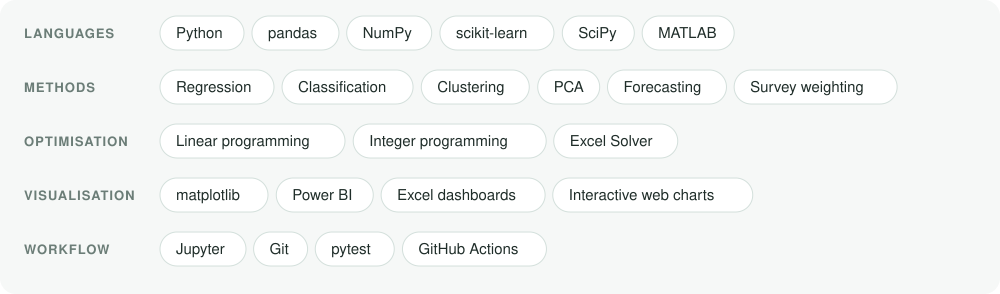
</picture>

MSE Data Science, Johns Hopkins University (2026–2028, Departmental Scholarship) · BSc Analytics and Sustainability Studies, Tata Institute of Social Sciences, Mumbai
