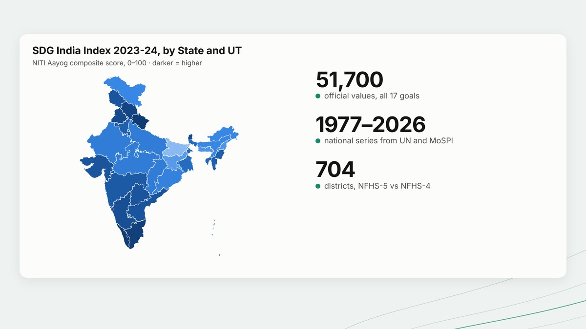

<picture>
  <source media="(prefers-color-scheme: dark)" srcset="assets/banner-dark.svg">
  
</picture>

<a href="https://sahil-ams-ds.lovable.app"><picture><source media="(prefers-color-scheme: dark)" srcset="assets/btn-website-dark.svg"></picture></a>
<a href="mailto:sfnu1@jh.edu"><picture><source media="(prefers-color-scheme: dark)" srcset="assets/btn-email-dark.svg"></picture></a>
<a href="https://sahiljangra12.github.io/Thesis/"><picture><source media="(prefers-color-scheme: dark)" srcset="assets/btn-chart-dark.svg"></picture></a>
<a href="https://github.com/sahiljangra12/Academic-Projects"><picture><source media="(prefers-color-scheme: dark)" srcset="assets/btn-projects-dark.svg"></picture></a>

I'm a data science graduate student at Johns Hopkins. I study how countries and cities balance development against pressure on the planet, using survey data, statistical models and machine learning, and I care about making that machine learning **trustworthy**: fair, interpretable and robust.

**Now:** building a neighbourhood-level heat-health risk index for Baltimore.

**Live:** [Planetary pressure chart](https://sahiljangra12.github.io/Thesis/) · [Energy transition dashboard](https://sahiljangra12.github.io/energy-transition-analysis/) · [SDG Explorer India](https://sahiljangra12.github.io/sdg-explorer-india/)

## Research projects

<table>
<tr>
<td width="33%" valign="top">

<h3><a href="https://github.com/sahiljangra12/Thesis">Planetary Boundaries and Development</a></h3>
A Planetary Pressure Index for 182 countries, pressure–development clusters, and how countries moved between them from 1990 to 2023.
  <a href="https://sahiljangra12.github.io/Thesis/"><b>Interactive chart →</b></a>
 Python · scikit-learn · pytest · GitHub Actions
</td>
<td width="33%" valign="top">

<h3><a href="https://github.com/sahiljangra12/energy-transition-analysis">Energy Transition and Development</a></h3>
Renewable energy across 215 countries, 2000–2021: the typical country's renewable electricity share doubled, and "renewable share" tells opposite stories about income for electricity and for all energy.
  <a href="https://sahiljangra12.github.io/energy-transition-analysis/"><b>Dashboard →</b></a>
 Python · World Bank and UN SDG data · Plotly
</td>
<td width="33%" valign="top">

<h3><a href="https://github.com/sahiljangra12/sdg-explorer-india">SDG Explorer India</a></h3>
India's progress on all 17 goals from four official sources: 51,700 values, national series back to 1977 and 704 districts, with every gap shown rather than filled.
  <a href="https://sahiljangra12.github.io/sdg-explorer-india/"><b>Explorer →</b></a>
 Python · PDF table extraction · validation · Plotly
</td>
</tr>
</table>

## Selected coursework

<table>
<tr>
<td width="33%" valign="top">

<h3><a href="https://github.com/sahiljangra12/Academic-Projects/tree/main/01-mumbai-aqi-forecasting">Mumbai Air Quality Forecasting</a></h3>
Explains, flags and forecasts daily AQI. The next-day model cuts error by 30% compared with a persistence baseline and warned a day ahead for 19 of 28 high-pollution days.
 Python · scikit-learn · time-ordered validation
</td>
<td width="33%" valign="top">

<h3><a href="https://github.com/sahiljangra12/Academic-Projects/tree/main/03-health-survey-analytics">Health Survey Analytics</a></h3>
Survey-weighted analysis of Indian government microdata for Uttarakhand: hospital use, out-of-pocket costs, and whether tobacco spending crowds out health spending.
 Python · survey weights · NSS / HCES microdata
</td>
<td width="33%" valign="top">

<h3><a href="https://github.com/sahiljangra12/Academic-Projects/tree/main/02-people-analytics">People Analytics Case Studies</a></h3>
A cross-validated hiring model that flags bias-risk predictors, factor analysis of a 26-item engagement survey, and an integer-programming hiring plan for a hospital network.
 Logistic regression · PCA · linear programming
</td>
</tr>
</table>

**More projects:** [Neural spike sorting](https://github.com/sahiljangra12/Academic-Projects/tree/main/13-neural-spike-sorting) · [SDG dashboard in Power BI](https://github.com/sahiljangra12/Academic-Projects/tree/main/05-sdg-powerbi-dashboard) · [BRICS sustainability report](https://github.com/sahiljangra12/Academic-Projects/tree/main/06-brics-sdg-report) · [SAARC SDG indicators](https://github.com/sahiljangra12/Academic-Projects/tree/main/07-saarc-sdg-dashboard) · [Energy profiles](https://github.com/sahiljangra12/Academic-Projects/tree/main/08-energy-profile-dashboards) · [Uttarakhand forest fires](https://github.com/sahiljangra12/Academic-Projects/tree/main/11-uttarakhand-forest-fires-2016) · [Speech signal processing](https://github.com/sahiljangra12/Academic-Projects/tree/main/04-speech-signal-processing) · [Hurricane damage in MATLAB](https://github.com/sahiljangra12/Academic-Projects/tree/main/09-storm-events-analysis-matlab) · [Optimisation models](https://github.com/sahiljangra12/Academic-Projects/tree/main/10-optimization-real-world-problems) · [Social impact assessment](https://github.com/sahiljangra12/Academic-Projects/tree/main/12-sabla-social-impact-assessment) · **[All 13 →](https://github.com/sahiljangra12/Academic-Projects)**

## Toolkit

<picture>
  <source media="(prefers-color-scheme: dark)" srcset="assets/toolkit-dark.svg">
  
</picture>

MSE Data Science, Johns Hopkins University (2026–2028, Departmental Scholarship) · BSc Analytics and Sustainability Studies, Tata Institute of Social Sciences, Mumbai
